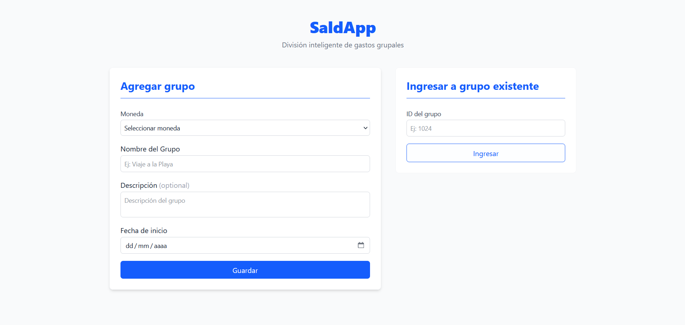
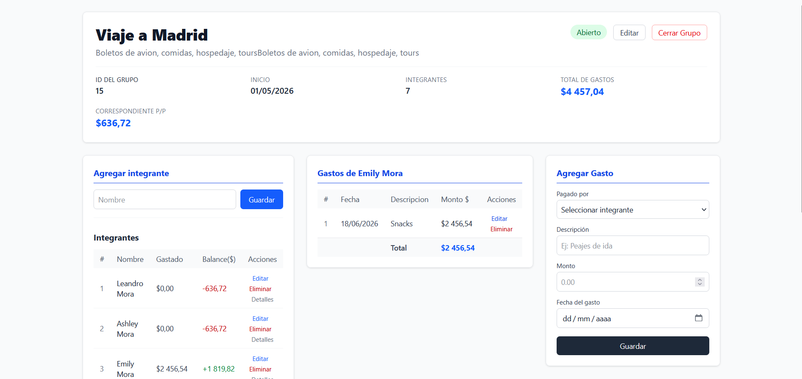
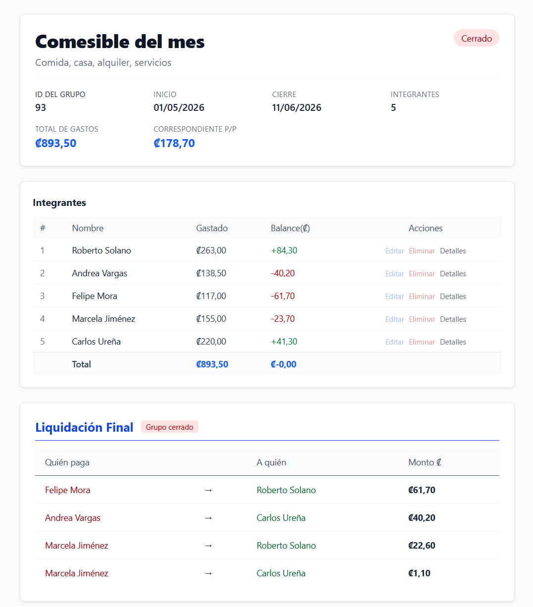

# SaldApp

> Read in English: [README.md](README.md)

Aplicación web full-stack para **dividir gastos en grupo**. Creás un grupo, agregás integrantes y gastos, y SaldApp calcula el balance de cada uno y el **mínimo de pagos** necesarios para saldar todas las deudas.

Este monorepo contiene las dos partes del proyecto, conservando el historial completo de commits de cada una:

| Carpeta | Qué es | Stack |
|---|---|---|
| [`backend/`](backend) | API REST, lógica de dominio y persistencia | Java 21, Spring Boot, JPA, PostgreSQL, Maven |
| [`frontend/`](frontend) | Cliente web (SPA) | React 19, Vite, React Router 7, Tailwind CSS 4 |

## Vista previa

<p>
  
</p>
<p>
  
</p>
<p>
  
</p>

## Funcionalidades

- CRUD completo de grupos, integrantes y gastos
- **Balance por integrante** en vivo y **plan de liquidación** (quién le paga a quién y cuánto)
- **Cierre de grupo**: un grupo cerrado pasa a ser de solo lectura
- Manejo de errores consistente de punta a punta (manejador global de excepciones en la API, interceptor de Axios en el cliente)
- Documentación interactiva de la API con Swagger UI

## Puntos destacados

- **Algoritmo de liquidación:** `SettlementCalculator` separa deudores y acreedores con dos colas de prioridad y empareja repetidamente la mayor deuda con el mayor crédito, manteniendo bajo el número de transacciones. Usa `BigDecimal` para el dinero y está cubierto con tests unitarios.
- **Backend limpio / hexagonal:** modelo de dominio puro, casos de uso detrás de puertos de entrada/salida, y adaptadores web y de persistencia.
- **Frontend organizado por dominio:** componentes, hooks y servicios agrupados por recurso (grupo, gasto, integrante, liquidación).

## Arquitectura

```
┌────────────────────┐   HTTP / JSON   ┌──────────────────────────┐     ┌────────────┐
│  frontend (React)  │ ──────────────▶ │  backend (Spring Boot)   │ ──▶ │ PostgreSQL │
│  Vite · :5173      │ ◀────────────── │  API REST · :8080        │ ◀── │   :5435    │
└────────────────────┘                 └──────────────────────────┘     └────────────┘
```

## Ejecutar en local

Requisitos: JDK 21+, Maven, Docker y Node.js 22+.

```bash
git clone https://github.com/leandro-mc/saldapp.git
cd saldapp

# 1. Backend  (API en http://localhost:8080, Swagger UI en /swagger-ui/index.html)
cd backend
cp .env.example .env          # configurar credenciales de la BD
docker compose up -d          # PostgreSQL en el puerto 5435
mvn spring-boot:run

# 2. Frontend (otra terminal, app en http://localhost:5173)
cd frontend
cp .env.example .env          # VITE_API_BASE_URL=http://localhost:8080
npm install
npm run dev
```

Más detalle en el README de cada proyecto: [backend](backend/README.es.md) · [frontend](frontend/README.es.md).

## Notas del repositorio

Este repositorio se armó uniendo los antiguos `saldapp-backend` y `saldapp-frontend` (reescritos dentro de `backend/` y `frontend/`) para conservar el historial de ambos: `git log -- backend` y `git log -- frontend` muestran los commits propios de cada proyecto. Las ramas laterales sin integrar se conservan como `backend/dev`, `frontend/dev` y `frontend/agents-mejorar-interfaz-gastos`.

## Licencia

[MIT](backend/LICENSE)
