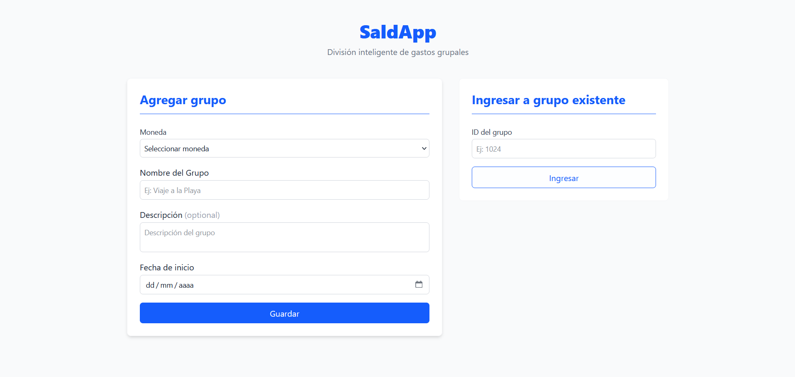
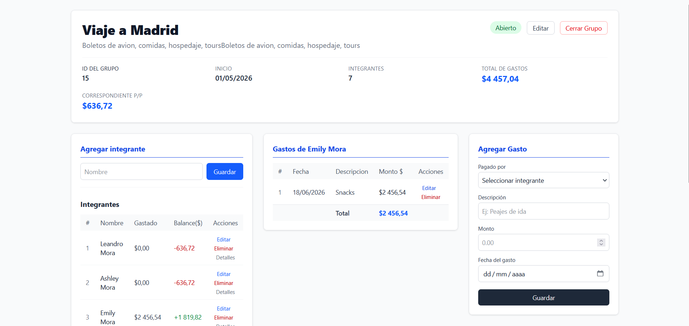
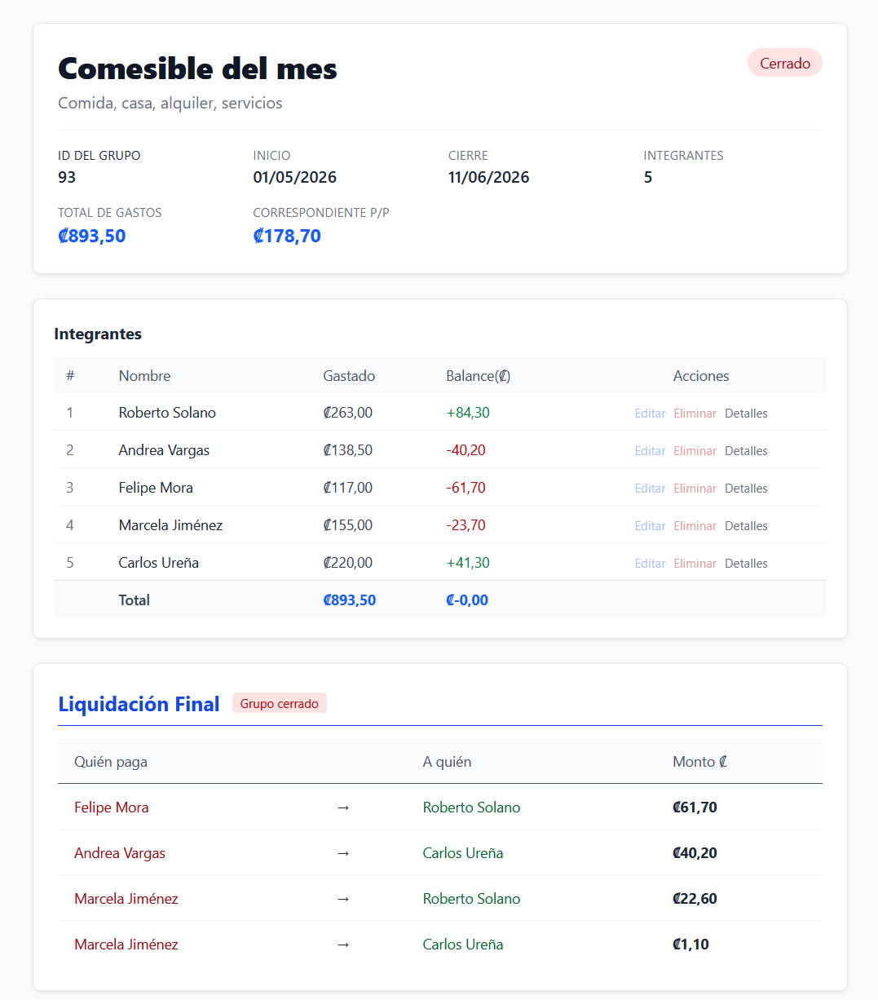

# SaldApp

> Leer en español: [README.es.md](README.es.md)

Full-stack web app for **splitting group expenses**. Create a group, add members and expenses, and SaldApp computes each member's balance and the **minimum set of payments** needed to settle every debt.

This monorepo contains both halves of the project, with the full commit history of each one preserved:

| Folder | What it is | Stack |
|---|---|---|
| [`backend/`](backend) | REST API, domain logic and persistence | Java 21, Spring Boot, JPA, PostgreSQL, Maven |
| [`frontend/`](frontend) | Single-page web client | React 19, Vite, React Router 7, Tailwind CSS 4 |

## Preview

<p>
  
</p>
<p>
  
</p>
<p>
  
</p>

## Features

- Groups, members and expenses with full CRUD
- Live **balance per member** and a **settlement plan** (who pays whom, and how much)
- Group **closing**: a closed group becomes read-only
- Consistent error handling end to end (global exception handler in the API, Axios interceptor in the client)
- Interactive API docs with Swagger UI

## Highlights

- **Settlement algorithm:** `SettlementCalculator` splits members into debtors and creditors with two priority queues and repeatedly matches the largest debt with the largest credit, keeping the number of transactions low. Money is handled with `BigDecimal`, and the algorithm is covered by unit tests.
- **Clean / hexagonal backend:** pure domain model, use cases behind input/output ports, and web and persistence adapters.
- **Frontend organised by domain:** components, hooks and services grouped per resource (group, expense, integrant, settlement).

## Architecture

```
┌────────────────────┐   HTTP / JSON   ┌──────────────────────────┐     ┌────────────┐
│  frontend (React)  │ ──────────────▶ │  backend (Spring Boot)   │ ──▶ │ PostgreSQL │
│  Vite · :5173      │ ◀────────────── │  REST API · :8080        │ ◀── │   :5435    │
└────────────────────┘                 └──────────────────────────┘     └────────────┘
```

## Run it locally

Requirements: JDK 21+, Maven, Docker and Node.js 22+.

```bash
git clone https://github.com/leandro-mc/saldapp.git
cd saldapp

# 1. Backend  (API on http://localhost:8080, Swagger UI at /swagger-ui/index.html)
cd backend
cp .env.example .env          # set DB credentials
docker compose up -d          # PostgreSQL on port 5435
mvn spring-boot:run

# 2. Frontend (new terminal, app on http://localhost:5173)
cd frontend
cp .env.example .env          # VITE_API_BASE_URL=http://localhost:8080
npm install
npm run dev
```

More details in each project's README: [backend](backend/README.md) · [frontend](frontend/README.md).

## Repository notes

This repository was built by merging the former `saldapp-backend` and `saldapp-frontend` repositories (rewritten into `backend/` and `frontend/`) so the history of both is kept: `git log -- backend` and `git log -- frontend` show each project's own commits. Unmerged side branches are preserved as `backend/dev`, `frontend/dev` and `frontend/agents-mejorar-interfaz-gastos`.

## License

[MIT](backend/LICENSE)
