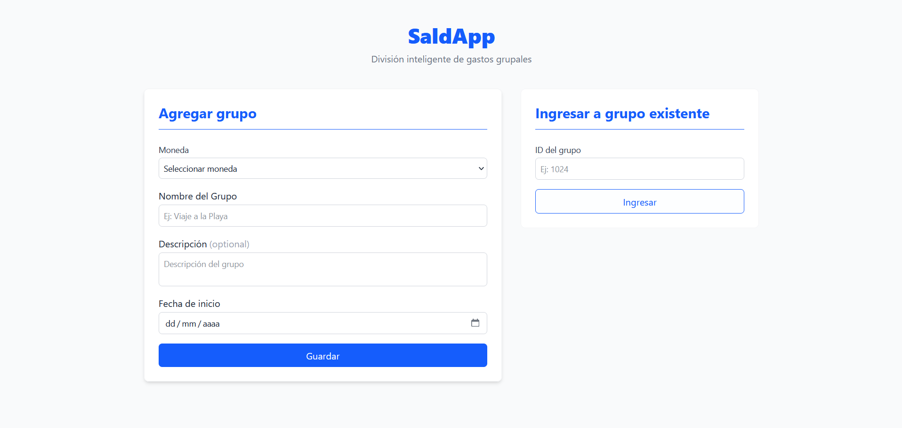
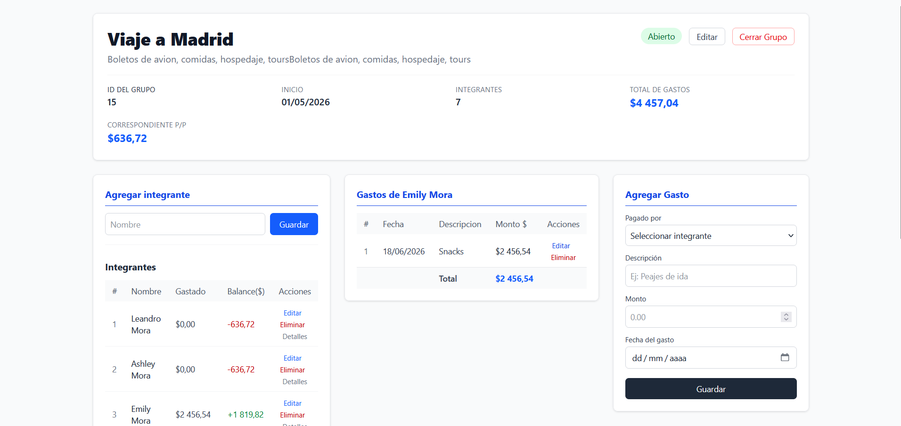
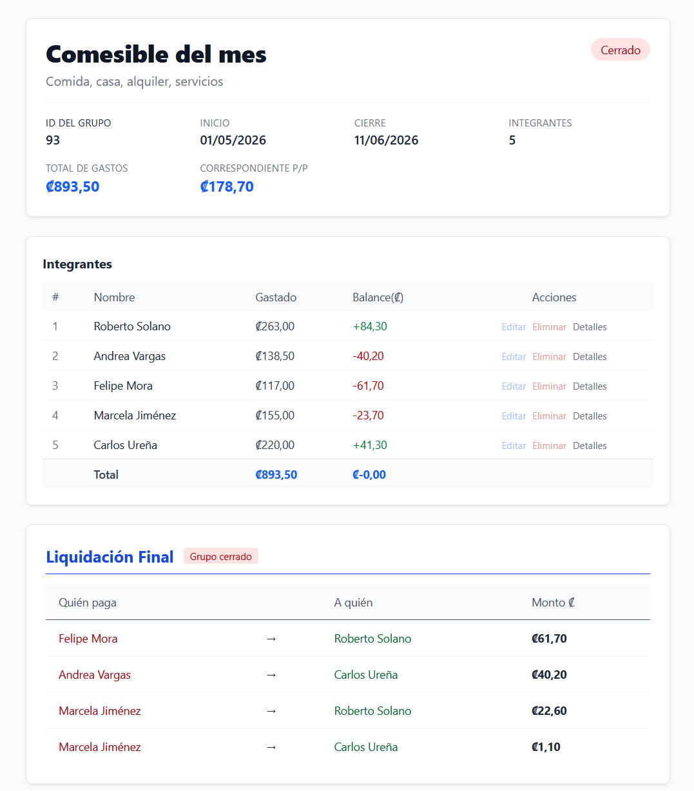

# SaldApp — Frontend

> Leer en español: [README.es.md](README.es.md)

Web app for splitting group expenses. Create a group, add members and expenses, and see who owes whom at a glance. Companion backend: [saldapp-backend](https://github.com/leandro-mc/saldapp-backend).

## Preview

<p>
  
</p>
<p>
  
</p>
<p>
  
</p>

## Features

- Create and manage groups, members and expenses
- Live balance per member and a settlement plan with the minimum payments
- Closed groups switch to a read-only view
- Loading, error and confirmation states handled consistently

## Tech stack

- React 19 and Vite
- React Router 7
- Axios with a global interceptor that normalizes API errors
- Tailwind CSS 4
- ESLint

## Getting started

Requirements: Node.js 22+ and the [backend](https://github.com/leandro-mc/saldapp-backend) running on `http://localhost:8080`.

```bash
git clone https://github.com/leandro-mc/saldapp-frontend.git
cd saldapp-frontend
cp .env.example .env     # VITE_API_BASE_URL points to the backend
npm install
npm run dev              # http://localhost:5173
```

## Demo mode (no backend)

With `VITE_DEMO_MODE=true` the app runs without a backend: an in-browser mock answers with sample groups and a banner says so. It lets you publish the frontend (e.g. on Vercel) as a portfolio piece. Switching modes requires a rebuild and redeploy. Full guide, Vercel settings and known limitations in [docs/demo-mode.md](docs/demo-mode.md) (in Spanish).

```bash
VITE_DEMO_MODE=true npm run dev
npm test        # calculation tests, with parity checks against the Java backend
```

## Structure

```
src/
├── pages/        # HomePage, GroupPage
├── components/   # UI by domain: group, expense, integrant, settlement, shared
├── hooks/        # Data and state logic (useGroup, useExpense, ...)
├── services/     # API calls per resource
├── config/       # Environment variables (env.js) and Axios client
├── demo/         # Demo-mode mock backend (only loaded when VITE_DEMO_MODE=true)
└── utils/        # Money, dates, error parsing
tests/            # node --test: calculation, mock API and fixtures generated with Java
```
